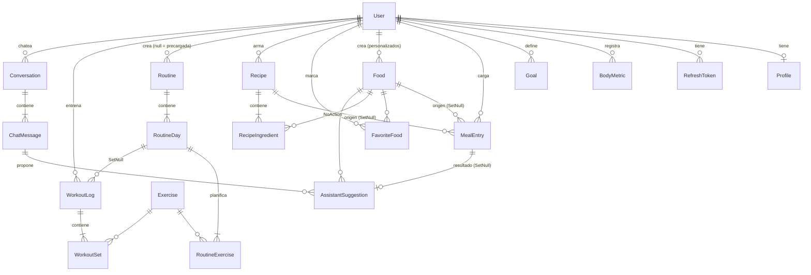

# Modelo de datos · primera migración (`InitialCreate`)

Propuesto por Santi el 21/10/2026 (S2). **Se ratifica en la reunión de hoy con Javi y Lauti antes de mergear.**
Si alguien necesita un campo más, lo agrega en su rama con su propia migración (una por PR).

## Convenciones

- Ids `int` autoincrementales. Tablas y columnas en PascalCase (default de Npgsql).
- Decimales `numeric(9,2)`. Enums guardados como **texto** (`'LoseFat'`, no `0`).
- `DateTime` en UTC (`timestamptz`). Días del diario y del peso como `DateOnly` (`date`), en la zona horaria del perfil.
- Borrar un `User` borra **todo** lo suyo en cascada (Ley 25.326, J5).
- Valores que se congelan al crearse: macros de `MealEntry`, targets de `Goal`, kcal de `WorkoutLog`.
- Lo que se puede calcular no se guarda: edad, peso actual, totales de receta, volumen, recientes.

## Diagrama

## Tablas

### Cuenta y perfil · usa Javi (J2–J8)

| Tabla | Campos | Reglas en la base |
|---|---|---|
| `Users` | Id, Email, PasswordHash, ConsentAcceptedAt, ConsentVersion, CreatedAt | Email único (se guarda en minúsculas) |
| `RefreshTokens` | Id, UserId, TokenHash, ExpiresAt, CreatedAt, RevokedAt? | TokenHash único; se guarda el hash, nunca el token |
| `Profiles` | Id, UserId, BirthDate, BiologicalSex, HeightCm, ActivityLevel, TimeZoneId, UpdatedAt | 1 a 1 con User; HeightCm > 0 |
| `BodyMetrics` | Id, UserId, Date, WeightKg, CreatedAt | Un registro por usuario y día; WeightKg > 0 |
| `Goals` | Id, UserId, GoalType, TargetWeightKg?, WeeklyRateKg, TargetCalories, TargetProteinG, TargetCarbsG, TargetFatG, IsActive, CreatedAt | **Un solo objetivo activo por usuario** (índice único parcial) |

Variables para Mifflin-St Jeor (J8): peso (último `BodyMetric`), altura, edad (desde `BirthDate`), sexo biológico y nivel de actividad. Con `BirthDate` se aplica también la regla de "sin déficit a menores de 18".

### Alimentos y comidas · usa Lauti (L1–L10)

| Tabla | Campos | Reglas en la base |
|---|---|---|
| `Foods` | Id, Name, NormalizedName, Brand?, Barcode?, Source, ExternalId?, CreatedByUserId?, CaloriesPer100g, ProteinPer100g, CarbsPer100g, FatPer100g, PortionName?, PortionWeightGrams?, CreatedAt | Único (Source, ExternalId) para el seed idempotente; índice trigram en NormalizedName; macros ≥ 0; si Source = Custom, tiene dueño |
| `MealEntries` | Id, UserId, FoodId?, RecipeId?, ItemName, Date, MealType, QuantityGrams, SavedCalories, SavedProtein, SavedCarbs, SavedFat, CreatedAt | Índice (UserId, Date); QuantityGrams > 0 |
| `FavoriteFoods` | UserId, FoodId, CreatedAt | Clave compuesta |
| `Recipes` | Id, UserId, Name, Servings, CreatedAt | Servings > 0 |
| `RecipeIngredients` | Id, RecipeId, FoodId, QuantityGrams | No se puede borrar un alimento usado en una receta |

- `Source`: `Argenfoods`, `OpenFoodFacts` o `Custom`. `CreatedByUserId` null = compartido (L8).
- `NormalizedName` lo arma el Manager (minúsculas, sin tildes). La búsqueda usa `ILIKE`/similitud de `pg_trgm` sobre esa columna (L1).
- `MealEntry` viene de un alimento **o** de una receta (lo valida el Manager). `ItemName` y los macros se copian al cargar.
- `QuantityGrams` siempre en gramos: si el usuario elige "2 unidades", el Manager multiplica por `PortionWeightGrams`.
- `Date` es el día local del usuario según `Profile.TimeZoneId` (L4, zona horaria).

### Rutinas y entrenamientos · usa Santi (S7–S8)

| Tabla | Campos | Reglas en la base |
|---|---|---|
| `Exercises` | Id, Name, MuscleGroup, MetValue | Catálogo compartido; Name único |
| `Routines` | Id, UserId?, Name, Description?, CreatedAt | UserId null = precargada |
| `RoutineDays` | Id, RoutineId, DayNumber, Name | Único (RoutineId, DayNumber) |
| `RoutineExercises` | Id, RoutineDayId, ExerciseId, Order, TargetSets, TargetReps, TargetWeightKg? | Lo planificado |
| `WorkoutLogs` | Id, UserId, RoutineDayId?, Date, DurationMinutes, EstimatedCaloriesBurned, Notes?, CreatedAt | Si se borra la rutina, el historial queda |
| `WorkoutSets` | Id, WorkoutLogId, ExerciseId, SetNumber, Reps, WeightKg | Lo realizado; índice por ejercicio para el progreso |

kcal estimadas = MET × peso (kg) × horas. Se guarda el número al registrar, siempre presentado como estimación.

### Asistente IA · usa Santi (S9–S10)

| Tabla | Campos | Reglas en la base |
|---|---|---|
| `Conversations` | Id, UserId, Title?, CreatedAt, UpdatedAt | — |
| `ChatMessages` | Id, ConversationId, Role, Content, CreatedAt | Role: User, Assistant, Tool |
| `AssistantSuggestions` | Id, UserId, ChatMessageId, FoodId, QuantityGrams, MealType, Date, Status, CreatedAt, ResolvedAt?, MealEntryId? | Status: Pending, Accepted, Ignored |

El LLM solo propone **qué alimento y cuántos gramos**. Al aceptar, la API crea el `MealEntry` con macros de `Foods` y guarda su Id en la sugerencia (D5, D6).

## Cambios respecto de las 5 clases iniciales

| Clase | Cambio | Por qué |
|---|---|---|
| `User` | + ConsentAcceptedAt, ConsentVersion | Registro con consentimiento (J2, Ley 25.326) |
| `Profile` | − Age, − CurrentWeight; + BirthDate, BiologicalSex, TimeZoneId; Height → HeightCm; ActivityLevel como enum | La edad guardada envejece; el peso actual duplica `BodyMetrics` y se desincroniza; Mifflin-St Jeor necesita el sexo; L4 necesita zona horaria |
| `Goal` | + GoalType, WeeklyRateKg, IsActive; TargetWeight opcional | Objetivo con ritmo semanal (J7) e historial con un solo activo |
| `Food` | + NormalizedName, Barcode, CreatedByUserId, CreatedAt; Source como enum | Búsqueda sin tildes (L1), código de barras (L3), personalizados (L8) |
| `MealEntry` | Quantity → QuantityGrams; + RecipeId, ItemName, CreatedAt; FoodId opcional | Unidad explícita, cargar recetas (L9), historial que sobrevive al borrado del alimento |
| `ApplicationDbContext` | 19 tablas; configuración por tabla en `/Configurations`; enums como texto; extensión `pg_trgm` | Cada uno toca su archivo de configuración: menos conflictos de merge |

Nuevas: `RefreshToken`, `BodyMetric`, `FavoriteFood`, `Recipe`, `RecipeIngredient`, `Exercise`, `Routine`, `RoutineDay`, `RoutineExercise`, `WorkoutLog`, `WorkoutSet`, `Conversation`, `ChatMessage`, `AssistantSuggestion`.
